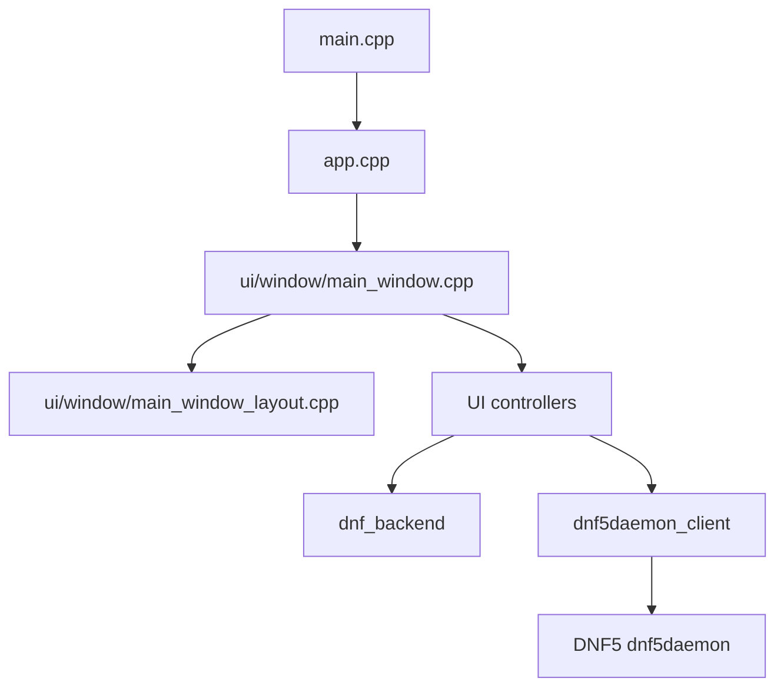
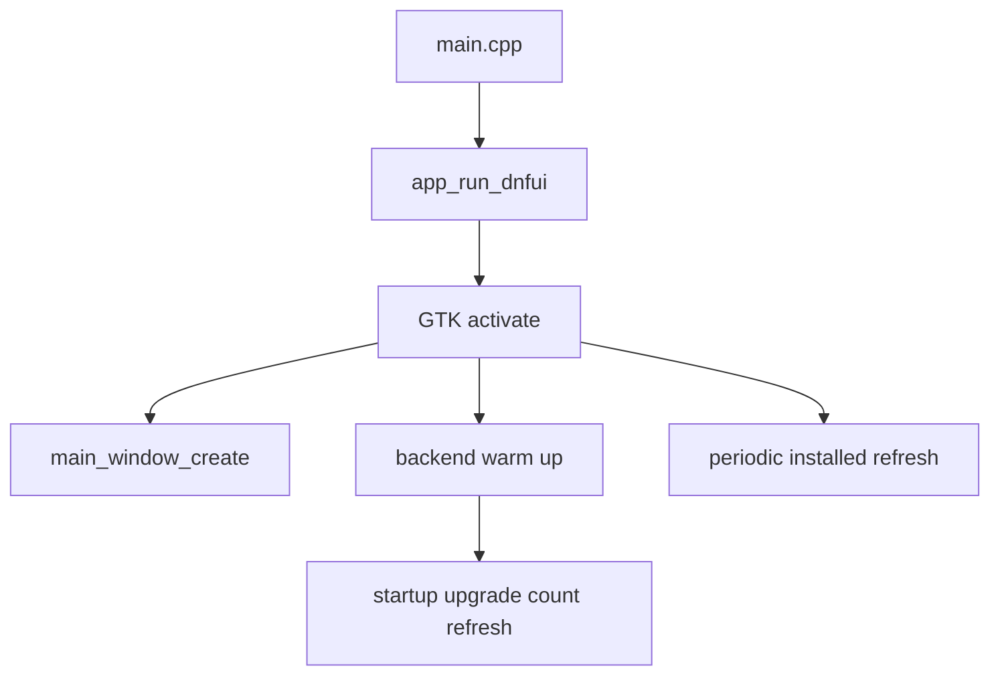
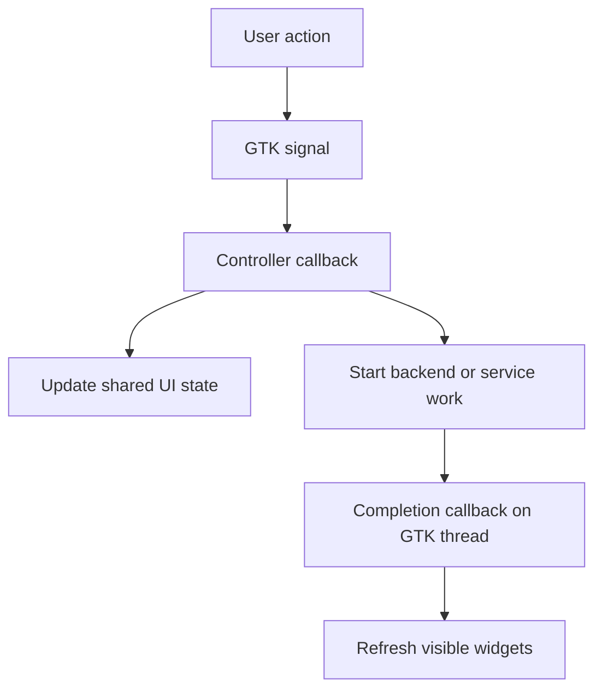
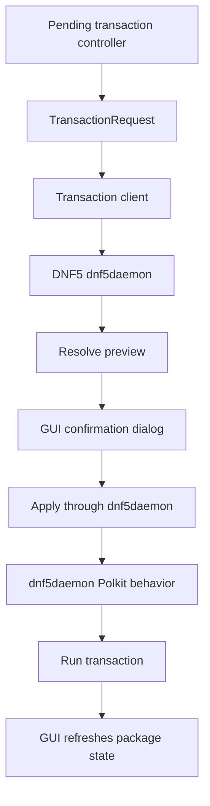

# DNF UI architecture

This is the overview document for DNF UI.

Use it as the first map when reading the code. The deeper documents are:

- [UI internals](ui.md)
- [Backend internals](backend.md)
- [Transaction flow](transactions.md)
- [Testing](testing.md)
- [External API assumptions](api-assumptions.md)
- [Project rules](project-rules.md)

## Purpose

DNF UI is a GTK 4 package manager frontend for DNF5 systems.

The main application stays unprivileged.
It searches packages, shows package details, lets the user mark package actions, and shows a review step.
Package changes are sent to DNF5 dnf5daemon, which owns the privileged package work and Polkit behavior.

## Key terms

- GTK is the user interface toolkit used to build the window.
- libdnf5 is the DNF5 package management library used for package queries and details.
- Base is the libdnf5 object that holds loaded repository and installed package state.
- rpmdb is the local database of packages installed on the system.
- NEVRA means name, epoch, version, release, and architecture. It identifies one exact package build.
- EVR means epoch, version, and release. The backend uses it when comparing package versions.
- D-Bus is the local message bus used by the GUI to call dnf5daemon.
- Polkit is the authorization service used by dnf5daemon before privileged package apply work.
- GTask is the GLib helper used to run slow work away from the GTK thread and return results safely.

## Main parts

The application is split into these main areas:

- Startup and main window setup
- UI controllers
- libdnf5 backend
- Shared transaction models
- dnf5daemon transaction client
- dnf5daemon repository client

## Package data and transaction data

DNF UI deliberately uses two package-management paths.

libdnf5 is used for package views. It is fast, runs in the unprivileged GUI process, and gives the app the
package details needed for the table, search, installed packages, files, dependencies, changelog text, and
read-only transaction history.

dnf5daemon is used for transaction decisions, package changes, and privileged repository configuration.
It is the service that resolves previews, applies transactions, handles Polkit authorization, persists repository
enabled state, and deals with repository signing keys. Anything that can change the system must go through dnf5daemon.

The daemon upgrade snapshot in [src/upgrade/daemon_upgrade_state.cpp](../src/upgrade/daemon_upgrade_state.cpp)
stores the latest complete read-only upgrade-target result reported by dnf5daemon. Only a `READY` snapshot may
be used as current upgrade information. Refreshing, stale, error, and not-loaded states must not be shown as
upgrade claims.

The List Upgradable view uses dnf5daemon to decide which upgrades exist. The worker loads one complete daemon
upgrade-target result and asks libdnf5 only for metadata that matches those exact package IDs.
The GTK completion publishes the daemon snapshot only when it accepts the matching table rows.
The table keeps a daemon-reported row visible even if libdnf5 metadata is missing,
because hiding that row would make the UI disagree with the service that applies upgrades.

This split is intentional, but it is also a boundary that may change in a later version if dnf5daemon gains a
better read API for the full package table.

## Startup

Startup follows a short path:

- [src/main.cpp](../src/main.cpp) calls `app_run_dnfui`
- [src/app.cpp](../src/app.cpp) creates the GTK application and handles activation
- [src/ui/window/main_window.cpp](../src/ui/window/main_window.cpp) creates the main window and wires signals
- [src/ui/window/main_window_layout.cpp](../src/ui/window/main_window_layout.cpp) builds the main window widget tree

After the window is created, `app.cpp` starts backend warm up, schedules the periodic installed-package
snapshot refresh, and then performs a quiet startup check for daemon-reported upgrades:

- backend warm up, so the first package query is faster
- periodic installed-package snapshot refresh
- startup upgrade count refresh, so the List Upgradable button can show a count before the user opens that view

## UI structure

The main window is created in [main_window.cpp](../src/ui/window/main_window.cpp), which also connects signals.
The widget tree is built in [main_window_layout.cpp](../src/ui/window/main_window_layout.cpp).
Controllers handle each part of the
window, using shared widget state from [widgets.hpp](../src/ui/common/widgets.hpp).
For the controller and helper files, see [UI internals](ui.md).

The UI controller pattern follows this shape:

## Backend structure

The UI does not use libdnf5 types directly.

The public backend API is [src/dnf_backend/dnf_backend.hpp](../src/dnf_backend/dnf_backend.hpp).
It exposes small value types such as `PackageRow` and `PackageInstallState`.
Resolved transaction previews are shared through [src/transaction/transaction_preview.hpp](../src/transaction/transaction_preview.hpp).
Async controllers use `BaseManager` directly for backend lifecycle work such as generation checks,
warmup, rebuilds, and memory release.

The backend implementation is split by responsibility:

- [src/dnf_backend/base_manager.cpp](../src/dnf_backend/base_manager.cpp) manages the shared libdnf5 `Base`.
- [src/dnf_backend/dnf_query.cpp](../src/dnf_backend/dnf_query.cpp) builds package rows for search, browse,
  and installed-list views.
- [src/dnf_backend/dnf_details.cpp](../src/dnf_backend/dnf_details.cpp) formats package details, files,
  dependencies, and changelog text.
- [src/dnf_backend/dnf_history.cpp](../src/dnf_backend/dnf_history.cpp) reads read-only transaction history.
- [src/dnf_backend/dnf_state.cpp](../src/dnf_backend/dnf_state.cpp) keeps installed-package snapshot state and
  package status classification.
- [src/upgrade/daemon_upgrade_target.hpp](../src/upgrade/daemon_upgrade_target.hpp) defines daemon-reported upgrade targets.
- [src/upgrade/daemon_upgrade_state.cpp](../src/upgrade/daemon_upgrade_state.cpp) keeps the latest complete
  daemon upgrade snapshot.

Most query and details calls take serialized read access to the shared Base.
That access is exclusive inside `BaseManager` because read-only `PackageQuery` work can still touch shared
libdnf5 `Base` internals.
Transaction preview and apply work goes through dnf5daemon instead of a local libdnf transaction path.
Transaction history uses a reusable query backed by a private system-only Base, so long history scans do not
hold the shared BaseManager lock while package searches are running. The query keeps the current filter,
transaction scan position, and matching value rows. This lets page navigation continue an existing scan and
serve previously discovered rows without rebuilding the Base or rescanning newer transactions.

The shared Base does not request changelog `other` metadata.
Changelog details read installed packages from the shared Base because rpmdb changelog metadata is local.
Available package changelogs use a temporary Base with repository changelog metadata,
after releasing the shared Base read lock.

## Package list model

With Latest only enabled, the main list shows one row for each package name and architecture pair.
With Latest only disabled, Search and List Packages show one row per exact available NEVRA and add missing
exact installed NEVRAs.

When repository metadata is available, repository candidates are shown.
Installed packages that do not have a visible repository candidate are added as local-only rows.
Installed packages can also be shown as upgradeable, older in the repository, or newer than the repository candidate.

The installed snapshot in [src/dnf_backend/dnf_state.cpp](../src/dnf_backend/dnf_state.cpp)
is important because it lets the UI answer:

- whether an exact NEVRA is installed
- whether a row is available, installed, local-only, upgradeable, or downgradeable
- whether a package owns the running GUI executable and must be protected from removal inside the app

## Transaction boundary

Search, browsing, and details stay inside the GUI process.

Preview and apply go through DNF5 dnf5daemon:

- GUI client:
  [src/dnf5daemon_client/transaction_service_client.cpp](../src/dnf5daemon_client/transaction_service_client.cpp)
- GUI client D-Bus calls:
  [src/dnf5daemon_client/transaction_service_client_dbus.cpp][wrapped-link-1]
- Offline status, preflight and cleanup D-Bus calls:
  [src/dnf5daemon_client/transaction_service_client_offline.cpp](../src/dnf5daemon_client/transaction_service_client_offline.cpp)
- GUI client daemon item parsing:
  [src/dnf5daemon_client/transaction_service_client_parser.cpp][wrapped-link-5]
- GUI client wait handling:
  [src/dnf5daemon_client/transaction_service_client_wait.cpp][wrapped-link-2]
- shared transaction models: [src/transaction/](../src/transaction/)

The client opens one dnf5daemon session for each prepared transaction.
The GUI shows the resolved preview, applies through the same session if the user confirms,
and closes the session when it is no longer needed.

## Packaging

Packaging metadata lives under [packaging](../packaging).

DNF UI requires Fedora `dnf5daemon-server` for package changes.
It does not install its own transaction service, Polkit policy, D-Bus policy, or systemd unit for package apply work.

Meson owns the real build and install rules. The `Makefile` is a task runner for common developer commands.

## Reading order

Start with [main.cpp](../src/main.cpp), [app.cpp](../src/app.cpp), and
[main_window.cpp](../src/ui/window/main_window.cpp) to see how the window starts. Then follow the code for
the task you are working on. [UI internals](ui.md), [Backend internals](backend.md), and
[Transaction flow](transactions.md) point to the relevant files.

[wrapped-link-1]: ../src/dnf5daemon_client/transaction_service_client_dbus.cpp
[wrapped-link-2]: ../src/dnf5daemon_client/transaction_service_client_wait.cpp
[wrapped-link-5]: ../src/dnf5daemon_client/transaction_service_client_parser.cpp
